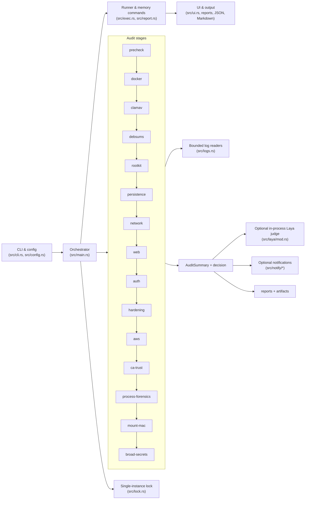

# rs-security-checker

A safe Rust port of the Debian security-audit pipeline in
[`jenkins-pipeline/Jenkinsfile`](jenkins-pipeline/Jenkinsfile) and
[`debian-scripts/main.sh`](debian-scripts/main.sh).

The binary runs all fifteen stages below and writes the same report artifacts as the shell and
Jenkins pipelines. The eight host-coverage stages are:

- **Web server logs** — nginx / Apache / Caddy access, error and JSON logs.
- **Authentication logs** — SSH, PAM, break-in markers and sudo denials.
- **Host hardening** — SSH daemon options, sysctl, firewall, sudoers, SUID/SGID, world-writable
  paths and password hygiene.
- **AWS host & metadata** — EC2 IMDSv1/v2, instance profile, static credential exposure, cloud-init
  user-data, AWS agents and clock synchronization.
- **CA trust & eMudhra** — compromised eMudhra/emSign entries in the OS trust store, matches in the
  compiled bundle, and pending `ca-certificates` updates.
- **Process forensics** — processes running from deleted executables, unlinked network listeners
  and top CPU/memory consumers.
- **Mount & MAC audit** — `noexec`/`nosuid`/`nodev` on `/tmp`, `/var/tmp` and `/dev/shm`, plus
  AppArmor or SELinux enforcement.
- **Broad secret discovery** — orphaned private keys, `.env` files and plaintext
  `.git-credentials` under home, web and opt roots.

It also offers two optional integrations:

- **`laya`** — an in-process typed-decision model that reads a compact summary and decides
  whether the result is worth notifying. No model server is required; an optional
  OpenAI-compatible backend is available for teams that serve a fine-tuned generative model.
- **`notifications`** — Slack incoming-webhook and Telegram Bot API delivery.

Both integrations are **off at compile time by default** and must also be enabled explicitly at
runtime. A default build only executes the audit scripts in a safe manner.

## Feature matrix

| Build | Command | Behaviour |
|---|---|---|
| Default | `cargo build --release` | Audit only. No network code, no notification code, no model code. |
| Notifications | `cargo build --release --features notifications` | Adds Slack + Telegram channels. |
| Laya | `cargo build --release --features laya` | Adds in-process Laya triage (optional OpenAI-compatible backend). |
| Full | `cargo build --release --all-features` | Both integrations. |

Runtime enablement is separate from compilation:

```bash
# Default build: no flags needed
./target/release/rs-security-checker --output-dir reports

# Notifications build: opt in with --notify (or NOTIFY_ENABLED=true)
SLACK_WEBHOOK_URL=... ./target/release/rs-security-checker --notify --output-dir reports

# Laya build: opt in with --laya (or LAYA_ENABLED=true).
# The default backend loads the Laya checkpoint in-process; no server is needed.
./target/release/rs-security-checker --laya --laya-model models/laya-base --output-dir reports
```

Passing `--notify` or `--laya` to a build that does not contain the feature is a configuration
error, not a silent no-op.

## Quick start

```bash
cargo build --release --all-features

# Inspect the commands without running them
./target/release/rs-security-checker --dry-run --verbose

# Run the full audit as root (or with passwordless sudo configured)
sudo ./target/release/rs-security-checker --output-dir reports --fail-on high

# Run only selected stages
./target/release/rs-security-checker --only docker,clamav --output-dir reports

# Machine-readable output on stdout, human logs on stderr
./target/release/rs-security-checker --json --output-dir reports > summary.json
```

Run `rs-security-checker --list-stages` to see the stage names accepted by `--only`/`--skip`.

## Pipeline mapping

| Jenkins stage                     | Rust stage          | Main commands                                                                                                                                                    | Artifact                       |
|-----------------------------------|---------------------|------------------------------------------------------------------------------------------------------------------------------------------------------------------|--------------------------------|
| Precheck & Dependencies           | `precheck`          | `dpkg -s`, optional `apt-get install`                                                                                                                            | —                              |
| Docker Security Audit             | `docker`            | `docker ps`, `docker inspect`                                                                                                                                    | `docker-audit-report.txt`      |
| ClamAV Scan                       | `clamav`            | `freshclam`, `clamscan`                                                                                                                                          | `clamav-report.txt`            |
| Debsums Integrity                 | `debsums`           | `debsums -cs`                                                                                                                                                    | `debsums-report.txt`           |
| Rootkit Audits                    | `rootkit`           | `chkrootkit -q`, `rkhunter`                                                                                                                                      | `rootkit-report.txt`           |
| Persistence & Account Audit       | `persistence`       | `/etc/passwd`, crontabs, `authorized_keys`, `systemctl`                                                                                                          | `persistence-report.txt`       |
| Network Sockets & Pending Patches | `network`           | `ss`, `apt-get update`, `apt-get --just-print upgrade`                                                                                                           | `network-updates-report.txt`   |
| Web Server Logs                   | `web`               | nginx/Apache access + error logs, Caddy JSON logs                                                                                                                | `web-logs-report.txt`          |
| Authentication Logs               | `auth`              | `auth.log`, `secure`, PAM/sshd/sudo records                                                                                                                      | `auth-logs-report.txt`         |
| Host Hardening                    | `hardening`         | `sshd -T`, sysctl files, `ufw`/`nft`/`iptables`, sudoers, file modes, `/etc/passwd` + `/etc/shadow`                                                              | `hardening-report.txt`         |
| AWS Host & Metadata               | `aws`               | `/etc/os-release`, EC2 IMDSv1/v2, instance identity/profile, `~/.aws/*`, user-data, `/etc/environment`, `/etc/profile.d`, ECS config, `systemctl`, `timedatectl` | `aws-report.txt`               |
| CA Trust & eMudhra Audit          | `ca-trust`          | `/etc/ca-certificates.conf`, `/etc/ssl/certs/ca-certificates.crt`, `apt-get update`, `apt-get --just-print upgrade ca-certificates`                              | `ca-trust-report.txt`          |
| Process Forensics                 | `process-forensics` | `/proc/*/exe`, `ss -tulpn`, `ps -eo ... --sort=-%cpu`                                                                                                            | `process-forensics-report.txt` |
| Mount & MAC Audit                 | `mount-mac`         | `/proc/self/mounts`, `aa-status --profiled`, `getenforce`                                                                                                        | `mount-mac-report.txt`         |
| Broad Secret Discovery            | `broad-secrets`     | `find` for `*.pem`, `*.key`, `id_rsa`, `id_ed25519`, `.env`, `.git-credentials`                                                                                  | `secrets-report.txt`           |

The web stage detects SQL injection, XSS, path traversal, command injection, Log4Shell,
Shellshock, XML external entities, PHP/web-shell and upload probes, sensitive-file probes, scanner
user agents, login brute force, 4xx/5xx spikes and TRACE requests. The auth stage detects failed
and invalid-user SSH logins, PAM failures, successful logins after a burst of failures, break-in
markers and sudo denials. The hardening stage checks SSH root/password/empty-password settings,
key sysctl values (configuration files and live kernel values), active firewall rules, sudoers
`NOPASSWD`/`!authenticate`, unexpected SUID/SGID files, world-writable paths, extra UID 0
accounts, empty passwords and weak MD5 hashes.

The AWS stage identifies the host OS, probes the link-local metadata service with short timeouts,
and flags IMDSv1 (SSRF credential theft), static `AKIA`/`ASIA` keys or secret fields in home
directories, cloud-init user-data, environment files and ECS agent configuration, private keys in
user-data, inactive SSM/CloudWatch/ECS agents, and an unsynchronized clock. It never calls the AWS
APIs, never prints credential values, and skips remote checks under `--dry-run`. Metadata requests
use `--noproxy '*'` so an inherited HTTP proxy cannot intercept link-local traffic.

The CA trust stage only reports entries that are actually enabled in
`/etc/ca-certificates.conf` (commented and `!`-disabled entries are ignored), looks for raw
eMudhra/emSign strings in the compiled bundle, and flags a pending `ca-certificates` upgrade as a
medium-severity finding. The process forensics stage resolves `/proc/*/exe` natively instead of
globbing in a shell, and the mount stage parses `/proc/self/mounts`, so both work without locale
or column-format assumptions. The broad secret discovery stage skips roots that do not exist and
caps the number of paths written to the report.

The network stage recognizes Debian and Ubuntu security pockets, including Ubuntu ESM/ESM-Apps
updates.

Log stages read only a bounded tail (4 MiB per file by default) so production logs cannot exhaust
memory. Compressed rotated logs are skipped and the partial first line of a tail is discarded.

The tool also writes `audit-summary.json` and `audit-summary.md` next to the artifacts.

## Parallel execution

The lightweight analysis stages (`web`, `auth`, `hardening`, `aws`) run concurrently with a small
bounded worker pool. `--parallel-jobs` controls the limit: `0` (default) selects 2–4 workers based
on the host, and `1` disables concurrency. Heavy stages (ClamAV, rootkit, debsums, Docker, network
package operations and precheck) remain serial and act as barriers.

Reports are collected and written in the original stage order, so `audit-summary.json`, the
Markdown summary and the artifacts stay deterministic. `--fail-fast` stops after the current
parallel chunk; stages that were never started are reported as skipped. In verbose mode,
per-command lines from concurrent stages may interleave, but stage summaries remain ordered.

## Safety model

The original pipeline embeds shell snippets. The Rust port does not invoke a shell:

- Commands are executed with an explicit `argv` (`std::process::Command`), so report content,
  paths, package names and container IDs can never be interpreted as shell syntax.
- `PATH` is fixed to `/usr/local/sbin:/usr/local/bin:/usr/sbin:/usr/bin:/sbin:/bin`; the inherited
  `PATH` is not used to resolve audit tools.
- Privileged commands use `sudo -n --` so a missing password fails instead of hanging the pipeline.
- Every command runs in its own process group with a deadline. On timeout the whole group is
  terminated (SIGTERM, then SIGKILL).
- stdout/stderr are drained concurrently and bounded (8 MiB per stream by default) so a noisy
  command cannot exhaust memory or deadlock on a full pipe.
- Commands run with a null stdin and a stable `LC_ALL=C`/`LANG=C` locale.
- Reports are written atomically (temp file + fsync + rename).
- A lock file prevents concurrent audit runs, mirroring Jenkins'
  `disableConcurrentBuilds()`.
- **Dependency installation is opt-in** with `--install-deps`; by default missing packages are
  reported as findings and nothing is installed.
- Docker inspection parses `docker inspect` JSON instead of piping through `grep`/`xargs`.
- Rootkit false-positive filtering is implemented with Rust regexes.
- The network stage inspects the local-address column of `ss` output, avoiding a false positive
  when only the peer address is `0.0.0.0`.
- Web and authentication log stages read a configurable, byte-bounded tail. They never load an
  entire production log, decompress rotated files, or follow symlinks found while expanding a log
  directory.
- The hardening stage reads configuration files with a 1 MiB cap and bounds the recursive file-mode
  scan by depth and entry count. Temporary directories are excluded from world-writable reporting
  and the scan never follows symlinks.
- The AWS stage only queries the fixed link-local metadata endpoint with a 2-second cap, bypasses
  proxies, bounds every file read to 1 MiB, and records credential findings without echoing secret
  values.
- Only `web`, `auth`, `hardening` and `aws` run concurrently. The shared command runner is
  thread-safe, and every command keeps its own process group, bounded output and deadline.
- The default Laya backend runs the model in-process and sends nothing over the network. The
  optional OpenAI-compatible backend refuses non-loopback endpoints unless `--laya-allow-remote`
  is set, and only sends the structured summary (never the full report artifacts).
- Slack/Telegram secrets are read from environment variables by preference and are redacted from
  error messages.

The audit is read-only apart from two intentional operations: `freshclam` signature updates (part
of the ClamAV stage) and `apt-get install` when `--install-deps` is explicitly passed.

## Configuration

### Important CLI flags

| Flag | Default | Purpose |
|---|---|---|
| `--output-dir <DIR>` | `.` | Artifact and summary directory. |
| `--timeout <SECS>` | `1800` | Global timeout, matching Jenkins' 30 minutes. |
| `--command-timeout <SECS>` | remaining global timeout | Per-command deadline. |
| `--max-output-bytes <BYTES>` | `8388608` | Capture limit per stream. |
| `--only <STAGES>` / `--skip <STAGES>` | all | Stage selection (comma-separated or repeated). |
| `--install-deps` | off | Allow `apt-get install` for missing precheck packages. |
| `--fail-fast` | off | Stop after the first failed/timed-out stage. |
| `--fail-on <SEVERITY>` | off | Exit 1 when the highest finding reaches this severity. |
| `--dry-run` | off | Print commands without executing them. |
| `--json` | off | JSON summary on stdout; human logs on stderr. |
| `--sudo-mode <auto\|always\|never>` | `auto` | Control `sudo -n` use. |
| `--lock-file <PATH>` | `/var/run/...` as root, temp dir otherwise | Concurrency lock. |
| `--no-lock` | off | Disable the lock (dry-run always does). |
| `--clamav-path <PATH>` | Jenkins paths | Override/additional ClamAV scan roots. |
| `--web-log <PATH>` | nginx/Apache/Caddy paths | Additional web log file or directory (repeatable). |
| `--auth-log <PATH>` | `/var/log/auth.log`, `/var/log/secure` | Additional authentication log (repeatable). |
| `--log-tail-bytes <BYTES>` | `4194304` | Maximum bytes read from the tail of each log file (minimum 1024). |
| `--parallel-jobs <JOBS>` | `0` (auto: 2–4) | Concurrent workers for `web`, `auth`, `hardening` and `aws`; `1` disables concurrency. |

### Notification variables

| Variable / flag | Purpose |
|---|---|
| `--notify`, `NOTIFY_ENABLED=true` | Enable delivery at runtime. |
| `--notify-on <SEVERITY>`, `NOTIFY_ON` | Heuristic threshold, default `high`. |
| `--notify-always` | Heuristic always says notify; laya can still veto. |
| `SLACK_WEBHOOK_URL` / `--slack-webhook` | Slack incoming webhook. |
| `TELEGRAM_BOT_TOKEN` / `--telegram-bot-token` | Telegram bot token. |
| `TELEGRAM_CHAT_ID` / `--telegram-chat-id` | Telegram chat id. |

At least one channel must be configured when `--notify` is used. Both channels can be enabled at
the same time; delivery failures are recorded per channel and do not change the audit exit code.

### Laya variables

| Variable / flag | Default | Purpose |
|---|---|---|
| `--laya`, `LAYA_ENABLED=true` | off | Enable local-model triage. |
| `LAYA_API` / `--laya-api` | `laya` | `laya` (in-process) or `openai` (OpenAI-compatible model server). |
| `LAYA_MODEL` / `--laya-model` | `models/laya-base` | Laya checkpoint directory, or model name for the server backend. |
| `LAYA_URL` / `--laya-url` | `http://127.0.0.1:8080/v1` | Base URL for `openai`; ignored by `laya`. |
| `LAYA_API_KEY` / `--laya-api-key` | — | Bearer token for OpenAI-compatible servers; ignored by `laya`. |
| `--laya-timeout <SECS>` | `120` | HTTP timeout for the server backend; ignored by `laya`. |
| `--laya-allow-remote` | off | Allow a non-loopback server endpoint; ignored by `laya`. |
| `--laya-max-chars <CHARS>` | `21000` | Maximum summary characters passed to the model. |
| `LAYA_MAX_TOKENS` / `--laya-max-tokens` | `8192` | Laya sequence budget. The shipped checkpoints use `512`–`1024`; `8192` is the encoder ceiling. |

The `laya` backend loads a [Laya](https://huggingface.co/convaiinnovations/laya) checkpoint
(`model.safetensors`, `encoder/`, `tokenizer/` and `rl_agent_config.json`) and evaluates the audit
summary in one in-process forward pass. It answers two typed questions — whether to notify and the
highest warranted severity — so there is no generated text to parse. Download the root or
`typed-decisions` checkpoint:

```bash
mkdir -p models/laya-base/encoder models/laya-base/tokenizer
B=https://huggingface.co/convaiinnovations/laya/resolve/main
for f in model.safetensors encoder/config.json tokenizer/tokenizer.json \
         tokenizer/tokenizer_config.json rl_agent_config.json; do
  curl -sL -o models/laya-base/$f "$B/$f"
done
```

Laya checkpoints ship with a 512–1,024-token sequence budget, which silently cuts long contexts
off. The checker raises `max_len` to `--laya-max-tokens` (8,192 by default, the encoder ceiling).
Before inference it estimates the context without a tokenizer (three bytes per token plus a 10%
margin); it logs a warning at 90% of the state budget and records a `laya_error` instead of letting
the model truncate the context. The default 21,000-character cap fits the default window even after
truncation; lower `--laya-max-chars` if you shrink the token budget, or pass `--laya-max-tokens 1024`
to keep the checkpoint's original budget.

The optional `openai` backend is separate: it asks a served generative model for exactly one JSON
object:

```json
{"notify": true, "severity": "high", "reason": "one short sentence"}
```

The [`laya-dataset/`](laya-dataset/README.md) folder contains the labelled typed-decision dataset
for that model: `{state, questions, expected}` rows for every audit stage plus cross-stage
scenarios, with `data/questions.json` kept aligned with `laya_questions()`. It also contains a
thin fine-tuning wrapper around Laya's `laya.train.finetune` that trains the multilingual base
(`convaiinnovations/laya-multilingual`) on those rows and evaluates on `valid.jsonl` and
`test.jsonl`:

```bash
cd laya-dataset
python3 -m venv .venv && source .venv/bin/activate
pip install -r requirements-train.txt
make finetune-check
make finetune            # writes ../models/laya-security
```

Point `--laya-model` at the resulting checkpoint:

```bash
./target/release/rs-security-checker --laya --laya-model models/laya-security
```

If the model is unavailable, returns an unexpected answer, or times out, the audit falls back to
the deterministic heuristic and records the error in `laya_error`. When laya succeeds it can both
approve and veto a notification, overriding the heuristic.

## Architecture



## Exit codes:

| Code | Meaning |
|---|---|
| `0` | Audit completed; no stage failed and `--fail-on` was not reached. |
| `1` | A stage failed/timed out, or `--fail-on` was reached. |
| `2` | Configuration error, disabled feature requested, lock held, or report write failure. |

Findings alone do not fail the run unless `--fail-on` is set. This mirrors the original Jenkins
pipeline, which archives reports without failing on their contents.

## Ubuntu and Debian support

The pipeline targets Ubuntu and Debian. The precheck stage uses `dpkg`, the network stage uses
`apt-get`, and the hardening stage understands `ufw`, `nft` and `iptables`; the AWS stage reads
`/etc/os-release` and reports a low-severity finding on other distributions instead of assuming
Debian paths. Ubuntu ESM and ESM-Apps security updates are included in the pending-patch report.

Jenkins agents should provide `cargo`/`rustc`, `curl`, and the audit packages (`clamav`,
`clamav-freshclam`, `debsums`, `rkhunter`, `chkrootkit`, `iproute2`). The example pipeline checks
the agent OS and toolchain first, warns when `curl` is missing, and can install missing audit
packages when the `INSTALL_DEPS` parameter is enabled.

## Jenkins integration

A ready-to-use pipeline is in
[`jenkins-pipeline/Jenkinsfile.rust`](jenkins-pipeline/Jenkinsfile.rust). It checks that the agent
is Ubuntu or Debian, verifies the Rust toolchain, optionally installs missing audit packages,
builds the binary with `--all-features`, runs the audit, and archives the report directory. The
original `Jenkinsfile` remains untouched for reference.

## Development

```bash
cargo fmt
cargo test --no-default-features
cargo test --all-features
cargo clippy --no-default-features --all-targets -- -D warnings
cargo clippy --all-features --all-targets -- -D warnings
cargo llvm-cov --no-default-features --summary-only
cargo llvm-cov --all-features --summary-only
cargo build --release --all-features
```

The default build is the one that ships, so both feature configurations are tested and linted.
Unit tests use a deterministic `FakeRunner`, so every stage branch (missing tools, timeouts,
malformed output, dry runs) runs without root or Debian tools. Integration tests in `tests/cli.rs`
exercise the real binary, including configuration errors, feature rejection, locking, and
end-to-end report writing. Coverage is measured with `cargo-llvm-cov`; the test suite covers every
audit stage, the safe process runner, configuration and CLI mapping, report rendering, file
locking, atomic writes, Laya typed-answer parsing and checkpoint loading errors, server endpoint
policy, and notification message formatting.
